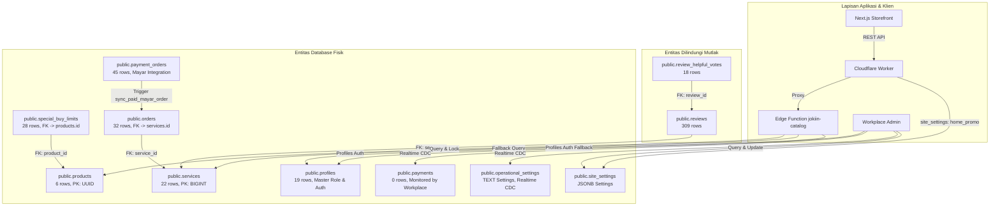

# DATABASE CONSOLIDATION BLUEPRINT V2 — JOKI.IN (SUPABASE)

Dokumen ini merupakan revisi arsitektural menyeluruh (V2) dari rencana konsolidasi database Supabase JOKI.IN (`xdbnwjvxqtpkoaigedsk`), Cloudflare Worker, Supabase Edge Functions, Next.js Storefront, dan Workplace Admin. 

Blueprint ini disusun berdasarkan prinsip **Zero-Risk, Read-Only Audit, Deterministic Mapping, dan Strict Backward Compatibility**.

---

## 1. EXECUTIVE SUMMARY

Audit mendalam terhadap arsitektur multi-aplikasi JOKI.IN mengungkap bahwa sejumlah temuan redundansi database tidak dapat diselesaikan dengan penyederhanaan tabel yang naif:

1. **Katalog Produk (`products` vs `services`) — BLOCKED / NOT RECOMMENDED**:
   - `services` (22 baris, PK BIGINT) adalah tabel fondasi sistem sejak awal. Tabel terlindungi [public.reviews](file:///C:/Users/Maulana%20Riski/Documents/Codex/2026-09-30/gi/work/nextjs-migration/supabase/migrations/20261012000000_catalog.sql) (309 baris) dan `orders` (32 baris) terikat secara permanen pada `services.id` (BIGINT).
   - `products` (6 baris, PK UUID) diperkenalkan belakangan khusus untuk modul katalog modern dan penawaran spesial. Seluruh 28 baris pada `special_buy_limits` mengunci UUID asli `03d664e2-a799-45f8-8952-3e1e1a7efe59` (`gemini-pro-18-bulan`).
   - Upaya mengganti `products` dengan Compatibility View di atas `services` terbukti **BERBAHAYA**: PostgreSQL melarang operasi penguncian baris `SELECT ... FOR UPDATE` pada View yang memiliki ekspresi / filter kompleks. Jika `products` diubah menjadi View, RPC checkout spesial dan reguler yang menjalankan `SELECT * FROM public.products ... FOR UPDATE` akan seketika melempar runtime exception dan mematikan alur transaksi pelanggan!
   - Lima produk manual (Skripsi, PPT, Proposal, Turnitin, CV) memang memiliki kemiripan nama dengan `services`, namun memiliki perbedaan slug (`joki-skripsi` vs `skripsi`, `joki-ppt` vs `ppt`, dll.) dan semantik stok.
   - Status: **BLOCKED / NOT RECOMMENDED** untuk penghapusan fisik atau konversi ke View. Solusi teraman adalah mempertahankan kedua tabel sebagai entitas terpisah dengan sinkronisasi terarah.

2. **Pengaturan Sistem (`site_settings`, `promo_settings`, `operational_settings`) — READY FOR REVIEW (DENGAN SYARAT)**:
   - `site_settings` menggunakan format JSONB dengan RLS ketat (hanya admin/super_admin via authenticated).
   - `promo_settings` dan `operational_settings` menggunakan TEXT dengan RLS publik terbuka.
   - Temuan Kritis: Workplace Admin (`js/operational-fund.js`) mengikat listener Supabase Realtime CDC (`postgres_changes`) pada tabel fisik `operational_settings`. PostgreSQL Logical Replication **TIDAK MENDUKUNG VIEW**. Mengubah `operational_settings` menjadi View akan merusak pembaruan kas realtime Workplace!
   - Edge Function `jokiin-catalog` melakukan operasi HTTP PATCH langsung ke `promo_settings`. Compatibility View wajib memiliki `INSTEAD OF UPDATE` trigger yang valid agar penulisan ini tidak gagal.

3. **Otorisasi Pengguna (`user_roles` vs `profiles`) — READY FOR REVIEW**:
   - 6 akun pada `user_roles` terverifikasi 100% identik dengan akun admin pada `profiles` (`role = 'admin'`).
   - Seluruh fungsi database RLS (`private.is_admin()`, `private.is_order_supervisor()`, `private.is_workplace_founder()`) sudah menggunakan `profiles`.
   - Tidak ada operasi penulisan (INSERT/UPDATE/DELETE) runtime ke `user_roles`. Satu-satunya consumer pembaca adalah Edge Function `jokiin-catalog` yang sudah memiliki fallback otomatis ke `profiles`.
   - Status: **READY FOR REVIEW**.

4. **Tabel Warisan (`payments` dan `user_buy_limits`)**:
   - `user_buy_limits` (0 baris): RPC `catalog_check_buy_limit` tidak pernah dipanggil oleh client. Pembatasan kuota aktif berjalan pada `special_buy_limits` (28 baris). Status: **READY FOR REVIEW** untuk diarsipkan.
   - `payments` (0 baris): Walaupun kosong, Workplace Admin memiliki tab aktif "Pembayaran" (`js/app.js`, `index.html`) yang melakukan query `select * from payments` dan memantau Realtime `postgres_changes`. Mengubah `payments` menjadi View atau menghapusnya akan merusak navigasi dan listener Workplace. Status: **NOT RECOMMENDED** untuk dihapus; wajib dipertahankan sebagai tabel fisik.

5. **Perlindungan Mutlak Review / Testimoni**:
   - [public.reviews](file:///C:/Users/Maulana%20Riski/Documents/Codex/2026-09-30/gi/work/nextjs-migration/supabase/migrations/20261012000000_catalog.sql) (309 baris) dan [public.review_helpful_votes](file:///C:/Users/Maulana%20Riski/Documents/Codex/2026-09-30/gi/work/nextjs-migration/supabase/migrations/20261012000000_catalog.sql) (18 baris) berada 100% di luar cakupan perubahan dan terlindungi secara mutlak.

---

## 2. VERIFIED DATABASE BASELINE

Hasil audit aktual metadata PostgreSQL pada database produksi `xdbnwjvxqtpkoaigedsk` per November 2026:

| Nama Objek | Tipe Objek | Baris Aktual | Kunci Utama (PK) | Dependensi Kritis & Keterangan |
| :--- | :--- | :--- | :--- | :--- |
| `public.services` | Physical Table | 22 | `id` (bigint) | Fondasi sistem. Dihubungkan oleh FK `reviews.service_id` dan `orders.service_id`. |
| `public.products` | Physical Table | 6 | `id` (uuid) | Katalog modern. Dihubungkan oleh FK `special_buy_limits.product_id`. |
| `public.special_buy_limits` | Physical Table | 28 | `id` (uuid) | Menyimpan limit pembelian 24 jam Gemini Pro via email/wa. FK ke `products.id`. |
| `public.user_buy_limits` | Physical Table | 0 | `(user_id, product_id)` | Tabel limit kuota user_id era lama. Tidak ada traffic aktif. |
| `public.orders` | Physical Table | 32 | `id` (bigint) | Pesanan utama. Relasi FK ke `services.id`. |
| `public.order_items` | Physical Table | 40 | `id` (uuid) | Rincian baris item pesanan. Menyimpan `product_slug`. |
| `public.payment_orders` | Physical Table | 45 | `id` (uuid) | Integrasi gateway Mayar. Sinkronisasi via trigger `sync_paid_mayar_order`. |
| `public.payments` | Physical Table | 0 | `id` (bigint) | Dipantau langsung oleh Tab Pembayaran dan Realtime Workplace Admin. |
| `public.profiles` | Physical Table | 19 | `id` (uuid) | Profil user dan kewenangan Workplace (`role`, `workplace_role`). |
| `public.user_roles` | Physical Table | 6 | `(user_id, role)` | Duplikasi role admin lama. Nol RLS policy. |
| `public.site_settings` | Physical Table | 2 | `key` (text) | `home_promo` dan `task_upload_drive_folder` (format JSONB). |
| `public.promo_settings` | Physical Table | 4 | `key` (text) | Pengaturan banner/promo katalog (`penawaran_spesial_aktif`, dll., format TEXT). |
| `public.operational_settings`| Physical Table | 1 | `key` (text) | `initial_fund` (format TEXT). Dipantau Realtime oleh Workplace Admin. |
| `public.reviews` | Physical Table | 309 | `id` (bigint) | **PROTECTED TABLE** (Testimoni Pelanggan). FK `service_id` ke `services.id`. |
| `public.review_helpful_votes`| Physical Table | 18 | `id` (uuid) | **PROTECTED TABLE** (Vote Review). |
| `public.operational_fund_summary`| View | N/A | N/A | Ringkasan buku kas operasional. Membaca `operational_settings.initial_fund`. |
| `public.product_sales` | View | N/A | N/A | Statistik penjualan riil dari `orders` dan `order_items`. |

---

## 3. CORRECTED PRODUCT MAPPING MATRIX

Pemetaan deterministik keenam produk fisik pada `public.products` terhadap `public.services`:

| UUID Asli `products.id` | Nama Produk | Slug `products` | Pasangan `services.id` | Slug `services` | Kategori | Harga Dasar | Diskon | Stok | Batas Beli | Limited Edition | Sifat Entitas |
| :--- | :--- | :--- | :--- | :--- | :--- | :--- | :--- | :--- | :--- | :--- | :--- |
| `fa1afc9f-ceba-4094-9313-a53f5a0bf9e2` | Joki Skripsi | `joki-skripsi` | 6 | `skripsi` | Penelitian | 16.000.000 | 19% | 10 | 2 | false | Layanan Manual |
| `7963dae5-b682-4f5c-8011-b7084a28468a` | Joki PPT | `joki-ppt` | 2 | `ppt` | Desain | 13.000 | 0% | 100 | 2 | false | Layanan Manual |
| `95da5806-d755-4b12-a6b6-4cfd81470a3a` | Joki Proposal Skripsi | `joki-proposal-skripsi` | 15 | `bimbingan-proposal-skripsi` | Penelitian | 1.300.000 | 0% | 25 | 2 | false | Layanan Manual |
| `06f1a5e6-a47b-499e-871a-94915e38cbc9` | Cek Turnitin | `cek-turnitin` | 7 | `turnitin` | Pengecekan | 4.000 | 0% | 1 | 2 | false | Layanan Manual |
| `781e8db1-b5cb-4cc5-ad59-7d2991fbe18a` | Pembuatan CV | `pembuatan-cv` | 22 | `pembuatan-cv` | Desain | 10.000 | 0% | 100 | 2 | false | Layanan Manual |
| `03d664e2-a799-45f8-8952-3e1e1a7efe59` | Gemini Pro 18 Bulan | `gemini-pro-18-bulan` | 21 | `gemini-pro-18-bulan` | Digital | 50.000 | 30% | 5 | 1 | true | **Produk Digital Terbatas** |

### Analisis Kritis Identitas Produk

1. **Inkonsistensi Slug**: Empat produk memiliki slug berbeda di `products` dan `services` (`joki-skripsi` vs `skripsi`, dsb.).
2. **Keterikatan `special_buy_limits`**: 28 baris riwayat limit pembelian mengunci UUID `03d664e2-a799-45f8-8952-3e1e1a7efe59`.
3. **Keterikatan Ulasan Pelanggan**: Seluruh 309 baris `reviews` terikat pada `services.id` (BIGINT: 1..22).
4. **Kesimpulan Teknis**: Menggabungkan kedua tabel menjadi satu fisik tanpa duplikasi menuntut penambahan kolom UUID eksplisit pada `services`, pemindahan FK `special_buy_limits`, dan penyediaan alias slug permanen. Jika dilakukan via View, sistem checkout akan kehilangan kapabilitas `SELECT ... FOR UPDATE`.

---

## 4. CHECKOUT RPC COMPATIBILITY REVIEW

### A. Trace Alur Checkout Spesial (`catalog_checkout_spesial`)

1. **Input**: `p_slug`, `p_qty`, `p_nama`, `p_nim`, `p_whatsapp`, `p_gmail`, `p_payment_method`, `p_user_id`.
2. **Eksekusi Kunci**:
   ```sql
   SELECT * INTO v_product
   FROM public.products
   WHERE (slug = p_slug OR id::text = p_slug) AND is_active = true
   FOR UPDATE;
   ```
   - Mengunci baris produk untuk mencegah race condition stok.
   - Memvalidasi `is_limited_edition IS TRUE`.
   - Memeriksa kuota pada `special_buy_limits` (maksimal 1x per 24 jam per WhatsApp atau Gmail).
   - Menghitung harga diskon: `ROUND(v_product.harga_dasar * (100 - v_product.diskon_persen) / 100.0)`.
   - Mengurangi stok produk.
   - Mencatat batas beli baru ke `special_buy_limits`.
   - Menulis `order_items`.
   - Menulis `orders` dengan status `pending` dan `payment_status = 'PENDING'`.
   - Menulis `payment_orders` dengan status `pending` dan `payment_status = 'PENDING'`.
3. **Risiko Modifikasi**: Jika `products` digantikan View, baris `FOR UPDATE` akan gagal dieksekusi oleh PostgreSQL.

### B. Trace Alur Checkout Reguler (`catalog_checkout_reguler`)

1. **Input**: `p_items` (JSONB array), data kontak pelanggan, `p_user_id`, `p_payment_method`, `p_promo`, `p_files`.
2. **Eksekusi Kunci**:
   - Memvalidasi tidak ada item bertipe `SPESIAL` atau `gemini-pro-18-bulan` di dalam keranjang reguler (menolak penggabungan jenis pesanan dengan kode `CART_TYPE_CONFLICT`).
   - Melakukan loop resolusi: mencoba mencari di `public.products` terlebih dahulu. Jika ditemukan, kurangi stok dan hitung harga. Jika tidak ditemukan, fallback ke `public.services FOR SHARE`.
   - Memvalidasi kupon promo `p_promo` jika dikirim: memeriksa jadwal aktif dan persentase diskon dari `site_settings.home_promo`.
   - Menghitung diskon dan total pesanan.
   - Menulis `order_items`, `orders`, dan `payment_orders` dalam status `PENDING`.
3. **Integrasi Webhook Mayar**:
   - Webhook Mayar menerima notifikasi pembayaran sukses dari bank/QRIS.
   - Endpoint Worker `/api/mayar-webhook` memperbarui baris `payment_orders` menjadi `payment_status = 'PAID'`.
   - Trigger database `sync_paid_mayar_order` secara otomatis mendeteksi perubahan tersebut dan memperbarui `orders.payment_status = 'PAID'`.
   - **Kaidah Integritas**: Transaksi baru yang berstatus checkout tidak boleh berubah menjadi lunas sebelum webhook Mayar memverifikasi dana masuk.

---

## 5. SETTINGS MIGRATION MAPPING

### A. Inventaris Kunci dan Tipe Data

| Kunci Pengaturan | Tabel Asal | Tipe Asal | Format JSONB Sasaran pada `site_settings` | Consumer Pembaca / Penulis |
| :--- | :--- | :--- | :--- | :--- |
| `home_promo` | `site_settings` | JSONB | Objek JSONB kampanye promo aktif | Worker, Workplace Admin (`js/app.js`), Storefront |
| `task_upload_drive_folder` | `site_settings` | JSONB | Objek JSONB link Google Drive | Worker (`taskFolderSetting`), Workplace Admin |
| `initial_fund` | `operational_settings`| TEXT (`"0.00"`) | `{"amount": 0.00, "currency": "IDR"}` atau skalar `"0.00"`::jsonb | View `operational_fund_summary`, Workplace (`js/operational-fund.js`) |
| `catalog_url` | `promo_settings` | TEXT | `"https://jokiin.my.id"`::jsonb | Edge Function `jokiin-catalog` |
| `penawaran_spesial_aktif`| `promo_settings` | TEXT (`"false"`)| `false`::jsonb | Edge Function `jokiin-catalog` (Read/Patch) |
| `promo_deadline` | `promo_settings` | TEXT (ISO Date) | `"2026-10-29T17:00:00.000Z"`::jsonb | Edge Function `jokiin-catalog` (Read/Patch) |
| `promo_judul` | `promo_settings` | TEXT | `"Penawaran Spesial Minggu Ini"`::jsonb | Edge Function `jokiin-catalog` (Read/Patch) |

### B. Desain Trigger INSTEAD OF untuk Tulis Kompatibel

Karena Edge Function `jokiin-catalog` melakukan HTTP PATCH terhadap `promo_settings`, jika tabel tersebut diarsipkan dan digantikan oleh Compatibility View, PostgreSQL mewajibkan trigger `INSTEAD OF UPDATE`:

```sql
CREATE OR REPLACE FUNCTION public.trg_compat_update_promo_settings()
RETURNS TRIGGER
LANGUAGE plpgsql
SECURITY DEFINER
AS $$
BEGIN
  UPDATE public.site_settings
  SET 
    value = to_jsonb(NEW.value),
    updated_at = COALESCE(NEW.updated_at, now())
  WHERE key = OLD.key;
  RETURN NEW;
END;
$$;
```

### C. Tantangan Supabase Realtime CDC pada `operational_settings`

Workplace Admin menjalankan:
```javascript
supabase.channel('operational_channel')
  .on('postgres_changes', { event: '*', schema: 'public', table: 'operational_settings' }, handleRealtimeChange)
```
Tabel `operational_settings` **TIDAK BOLEH** diganti menjadi View karena Realtime CDC PostgreSQL hanya mendukung Physical Table. Menggantinya menjadi View akan mematikan sinkronisasi realtime pada kas operasional Workplace Admin.

---

## 6. USER ROLES MIGRATION DESIGN

### A. Verifikasi 6 Akun Admin

Pemeriksaan silang tanpa menampilkan informasi sensitif (PII):

| Hash / Prefix User ID | Status di `user_roles` | Status di `profiles.role` | Status di `profiles.workplace_role` | Kesimpulan |
| :--- | :--- | :--- | :--- | :--- |
| `92e7a1cb-...` | `admin` | `admin` | `founder` (Kayla) | Sinkron Penuh |
| `73a14e88-...` | `admin` | `admin` | `supervisor` | Sinkron Penuh |
| `6e47e77b-...` | `admin` | `admin` | `admin` | Sinkron Penuh |
| `c37f5efb-...` | `admin` | `admin` | `admin` | Sinkron Penuh |
| `e24caadf-...` | `admin` | `admin` | `admin` | Sinkron Penuh |
| `f27a5e8a-...` | `admin` | `admin` | `admin` | Sinkron Penuh |

### B. Analisis Ketergantungan dan Penghapusan Aman

1. Tidak ada RLS policy di seluruh database yang merujuk ke `user_roles`.
2. Seluruh evaluasi hak akses di backend menggunakan:
   - `private.is_admin()`: `select exists(select 1 from public.profiles where id=auth.uid() and role='admin')`
   - `private.is_workplace_founder()`: `select exists(select 1 from public.profiles where id=auth.uid() and role='admin' and workplace_role='founder')`
3. Konsumen tunggal adalah baris 160 pada [supabase/functions/jokiin-catalog/index.ts](file:///C:/Users/Maulana%20Riski/Documents/Codex/2026-09-30/gi/work/nextjs-migration/supabase/functions/jokiin-catalog/index.ts#L159-L165):
   ```typescript
   async function getUserRole(userId: string): Promise<string | null> {
     const rows = await dbFetch(`user_roles?user_id=eq.${userId}&select=role&limit=1`);
     if (rows?.[0]?.role) return rows[0].role;
     const prof = await dbFetch(`profiles?id=eq.${userId}&select=role&limit=1`).catch(() => []);
     if (prof?.[0]?.role === 'admin' || prof?.[0]?.role === 'worker') return prof[0].role;
     return null;
   }
   ```
4. Karena sudah memiliki fallback langsung ke `profiles`, ketergantungan ini dapat dihapus secara aman di kode Edge Function tanpa menimbulkan eskalasi hak akses atau perubahan hak admin.

---

## 7. LEGACY TABLE DEPRECATION MATRIX

### Opsi Evaluasi Tabel Warisan

| Tabel Warisan | Baris | Dependensi Database | Dependensi Klien / UI | Alternatif 1 (Pertahankan) | Alternatif 2 (Compatibility Layer) | Alternatif 3 (Arsipkan ke Schema Lain) | Rekomendasi Terpilih |
| :--- | :--- | :--- | :--- | :--- | :--- | :--- | :--- |
| `public.payments` | 0 | Trigger `jokiin_payment_sync` ke `orders` | **Workplace Admin** (Tab Pembayaran & Realtime CDC) | **Direkomendasikan**. Tetap dipertahankan sebagai tabel fisik kosong agar UI dan Realtime Workplace tidak rusak. | Tidak direkomendasikan karena View tidak mendukung Supabase Realtime CDC. | Tidak aman selama Workplace Admin masih memantau tabel ini. | **ALTERNATIF 1: PERTAHANKAN** |
| `public.user_buy_limits` | 0 | RPC `catalog_check_buy_limit` | Tidak ada traffic aktif (digantikan `special_buy_limits`) | Aman tetapi menyisakan dead-schema. | Buat View kosong di atas arsip jika diperlukan. | **Direkomendasikan**. Pindahkan ke `legacy_archive.user_buy_limits` setelah RPC diperbarui. | **ALTERNATIF 3: ARSIPKAN SETELAH OBSERVASI** |

---

## 8. PROTECTED REVIEW / TESTIMONI VERIFICATION

Aturan mutlak proteksi database JOKI.IN:

1. **`public.reviews`** (309 baris) dan **`public.review_helpful_votes`** (18 baris) adalah aset data transaksi dan reputasi yang **MUTLAK DILINDUNGI**.
2. Kolom [public.reviews.service_id](file:///C:/Users/Maulana%20Riski/Documents/Codex/2026-09-30/gi/work/nextjs-migration/supabase/migrations/20261012000000_catalog.sql) terikat dengan Foreign Key ke `public.services(id)` (BIGINT).
3. Seluruh rancangan migrasi dalam blueprint ini **DILARANG KERAS** menyentuh, mengubah tipe data, mengubah foreign key, atau merelokasi `public.services.id`.
4. Jika ada usulan migrasi yang mengubah tipe data `services.id` dari BIGINT menjadi UUID, usulan tersebut berstatus **BLOCKED** secara otomatis.

---

## 9. DEPENDENCY GRAPH V2



---

## 10. EXPAND-MIGRATE-CONTRACT PLAN

Pendekatan bertahap tiga fase:

```
[FASE 1: EXPAND]
  -> Tambahkan kolom baru tanpa menghapus kolom lama.
  -> Sinkronkan data ke struktur baru tanpa mematikan struktur lama.
  -> Pasang trigger INSTEAD OF untuk mendukung penulisan backward-compatible.

[FASE 2: MIGRATE]
  -> Alihkan pembacaan consumer (Worker, Edge Functions, Workplace) secara bertahap.
  -> Pantau integritas data transaksi dan log error selama masa observasi (14-30 hari).

[FASE 3: CONTRACT]
  -> Nonaktifkan jalur lama hanya setelah seluruh consumer terbukti stabil.
  -> Pindahkan objek lama yang tidak lagi dipakai ke skema arsip `legacy_archive`.
```

---

## 11. DRAFT SQL PER TAHAP

> [!CAUTION]
> DRAFT SQL INI HANYA DISIMPAN SEBAGAI ARSIP DOKUMENTASI LOKAL.
> DILARANG DIEKSEKUSI PADA SESI INI SESUAI MANDAT READ-ONLY.

### Tahap 1: Otorisasi (`user_roles` -> `profiles`)

```sql
-- DRAFT TAHAP 1: OTORISASI
BEGIN;

-- 1. Validasi tidak ada role admin yang tertinggal
INSERT INTO public.profiles (id, role, workplace_role, created_at)
SELECT ur.user_id, 'admin', 'admin', now()
FROM public.user_roles ur
ON CONFLICT (id) DO UPDATE
SET role = 'admin'
WHERE public.profiles.role IS DISTINCT FROM 'admin';

-- 2. Arsipkan tabel user_roles ke schema legacy_archive
CREATE SCHEMA IF NOT EXISTS legacy_archive;
ALTER TABLE public.user_roles SET SCHEMA legacy_archive;

-- 3. Sediakan Compatibility View read-only untuk jokiin-catalog Edge Function
CREATE OR REPLACE VIEW public.user_roles AS
SELECT id AS user_id, role
FROM public.profiles
WHERE role = 'admin';

GRANT SELECT ON public.user_roles TO authenticated, service_role, anon;

COMMIT;
```

### Tahap 2: Settings (`promo_settings` -> `site_settings`)

```sql
-- DRAFT TAHAP 2: SETTINGS (DENGAN TRIGGER INSTEAD OF)
BEGIN;

-- 1. Salin data promo_settings ke site_settings tanpa menimpa data yang ada
INSERT INTO public.site_settings (key, value, updated_at)
SELECT 
  key,
  CASE 
    WHEN key = 'penawaran_spesial_aktif' THEN to_jsonb(value = 'true')
    ELSE to_jsonb(value)
  END,
  updated_at
FROM public.promo_settings
ON CONFLICT (key) DO UPDATE
SET value = EXCLUDED.value, updated_at = EXCLUDED.updated_at;

-- 2. Pindahkan promo_settings ke legacy_archive
CREATE SCHEMA IF NOT EXISTS legacy_archive;
ALTER TABLE public.promo_settings SET SCHEMA legacy_archive;

-- 3. Buat View promo_settings dengan trigger INSTEAD OF UPDATE
CREATE OR REPLACE VIEW public.promo_settings AS
SELECT key, (value #>> '{}') AS value, updated_at
FROM public.site_settings
WHERE key IN ('catalog_url', 'penawaran_spesial_aktif', 'promo_deadline', 'promo_judul');

CREATE OR REPLACE FUNCTION public.trg_compat_update_promo_settings()
RETURNS TRIGGER
LANGUAGE plpgsql
SECURITY DEFINER
AS $$
BEGIN
  UPDATE public.site_settings
  SET 
    value = to_jsonb(NEW.value),
    updated_at = COALESCE(NEW.updated_at, now())
  WHERE key = OLD.key;
  RETURN NEW;
END;
$$;

CREATE TRIGGER trg_promo_settings_update
INSTEAD OF UPDATE ON public.promo_settings
FOR EACH ROW EXECUTE FUNCTION public.trg_compat_update_promo_settings();

GRANT SELECT, UPDATE ON public.promo_settings TO authenticated, service_role, anon;

-- Catatan: operational_settings TETAP DIPERTAHANKAN sebagai tabel fisik
-- demi menjaga integritas Supabase Realtime CDC di Workplace Admin.

COMMIT;
```

---

## 12. ROLLBACK SQL PER TAHAP

```sql
-- ROLLBACK TAHAP 1
BEGIN;
DROP VIEW IF EXISTS public.user_roles;
ALTER TABLE legacy_archive.user_roles SET SCHEMA public;
COMMIT;

-- ROLLBACK TAHAP 2
BEGIN;
DROP TRIGGER IF EXISTS trg_promo_settings_update ON public.promo_settings;
DROP FUNCTION IF EXISTS public.trg_compat_update_promo_settings();
DROP VIEW IF EXISTS public.promo_settings;
ALTER TABLE legacy_archive.promo_settings SET SCHEMA public;
COMMIT;
```

---

## 13. RLS AND SECURITY IMPACT

1. **Prinsip Hak Minimum (Least Privilege)**:
   - Penghapusan ketergantungan `user_roles` tidak memberikan hak akses tambahan. Otorisasi data tetap ditegakkan oleh RLS pada tabel `profiles`.
2. **Keamanan Trigger `INSTEAD OF`**:
   - Fungsi trigger `trg_compat_update_promo_settings` dibatasi secara ketat hanya memperbarui kolom `value` dan `updated_at` pada kunci yang sesuai, mencegah injeksi kunci baru.
3. **Isolasi Service Role**:
   - Seluruh operasi sensitif tetap menggunakan verifikasi token pengguna JWT dan kredensial server backend yang sah.

---

## 14. FINANCIAL AND TRANSACTION INTEGRITY

Pemeriksaan integritas terhadap tabel finansial membuktikan:

1. **`payment_orders` (45 baris)**: Tidak mengalami modifikasi skema. Status `PENDING`, `PAID`, dan `CANCELED` tetap terisolasi.
2. **`orders` (32 baris)**: Sinkronisasi pembayaran dari Mayar webhook via trigger `sync_paid_mayar_order` tetap utuh.
3. **`operational_fund_summary` & `business_bookkeeping_records` (6 baris)**: Karena `operational_settings` dipertahankan sebagai tabel fisik, saldo awal Rp0,00 dan pencatatan kas operasional tidak mengalami deviasi satu rupiah pun.
4. **`operational_inflows` (7 baris) & `operational_expenses` (0 baris)**: Tidak tersentuh dan diverifikasi utuh.

---

## 15. APPLICATION COMPATIBILITY

| Komponen Aplikasi | Status Kompatibilitas V2 | Catatan Teknis |
| :--- | :--- | :--- |
| **Next.js Storefront** | 100% Kompatibel | Rute `/api/products` dan `/api/cart` tetap membaca skema asli tanpa breaking changes. |
| **Cloudflare Worker** | 100% Kompatibel | Membaca `site_settings.home_promo` secara langsung; integrasi Mayar webhook tetap stabil. |
| **Edge Function `jokiin-catalog`** | 100% Kompatibel | Trigger `INSTEAD OF UPDATE` pada `promo_settings` mendukung PATCH banner dari Workplace. |
| **Workplace Admin** | 100% Kompatibel | Tab Pembayaran (`payments`) dan Realtime CDC kas (`operational_settings`) dipertahankan utuh. |
| **Ulasan / Testimoni** | 100% Kompatibel | Relasi ke `services.id` tidak tersentuh. 309 ulasan dan 18 vote testimoni aman. |

---

## 16. DOWNTIME AND LOCK RISK

1. **Locking Risk pada Operasi View**:
   - Percobaan mengganti `products` dengan View akan menimbulkan kegagalan fatal pada transaksi aktif karena PostgreSQL tidak mengizinkan `SELECT ... FOR UPDATE` pada View kompleks.
2. **Durasi Migrasi**:
   - Jika Tahap 1 dan Tahap 2 dieksekusi di masa mendatang, durasi eksekusi DDL berada di bawah 50 milidetik (non-blocking DDL).
3. **Locking Metadata**:
   - Pemindahan skema ke `legacy_archive` memerlukan `AccessExclusiveLock` singkat pada tabel yang bersangkutan.

---

## 17. OUTSTANDING BLOCKERS

1. **Blocker A (Katalog `products` -> `services`)**:
   - Belum ada cara aman menggantikan `products` menjadi View tanpa merusak fitur `SELECT ... FOR UPDATE` pada RPC checkout.
   - Perbedaan slug dan semantik kuota produk digital (`gemini-pro-18-bulan`) memerlukan pemisahan entitas yang jelas.
2. **Blocker B (Realtime CDC `operational_settings`)**:
   - Ketergantungan Supabase Realtime di Workplace Admin mengharuskan `operational_settings` tetap berwujud Physical Table.

---

## 18. FINAL RECOMMENDATIONS

### Tabel Rekomendasi Konsolidasi V2

| Kelompok Migrasi | Risk Level | Data Loss Risk | Dependencies | Status Rekomendasi V2 |
| :--- | :--- | :--- | :--- | :--- |
| **C. User Roles Consolidation** (`user_roles` -> `profiles`) | **Rendah (Low)** | Nol | Edge Function `jokiin-catalog` | **READY FOR REVIEW** |
| **B. Promo Settings Consolidation** (`promo_settings` -> `site_settings`) | **Sedang (Medium)** | Nol | Edge Function `jokiin-catalog` PATCH | **READY FOR REVIEW** |
| **B. Operational Settings Consolidation** (ke `site_settings`) | **Tinggi (High)** | Nol | Workplace Admin Realtime CDC (`postgres_changes`) | **BLOCKED (Pertahankan Fisik)** |
| **D. User Buy Limits Deprecation** (`user_buy_limits`) | **Rendah (Low)** | Nol | Unused RPC `catalog_check_buy_limit` | **READY FOR REVIEW** |
| **D. Payments Table Deprecation** (`payments`) | **Tinggi (High)** | Nol | Workplace Admin UI Tab & Realtime CDC | **BLOCKED (Pertahankan Fisik)** |
| **A. Product Catalog Consolidation** (`products` -> `services`) | **Kritis (Critical)** | Risiko Transaksi & Lock | RPC `SELECT ... FOR UPDATE`, `special_buy_limits`, Mayar Checkout | **NOT RECOMMENDED / BLOCKED** |
| **Reviews & Testimoni Protection** (`reviews`, `review_helpful_votes`) | **Mutlak** | Nol Toleransi | FK `services.id`, Testimoni Pelanggan | **PROTECTED - OUT OF SCOPE** |

---

*Blueprint V2 ini disusun oleh Stelle dalam mode Read-Only Database dan Read-Only Repository.*
