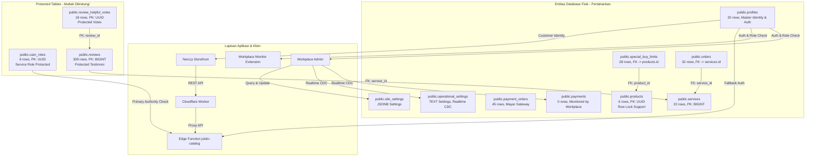

# DATABASE CONSOLIDATION BLUEPRINT V3: PROTECT USER_ROLES - JOKI.IN (SUPABASE)

Dokumen ini merupakan pembaruan arsitektural resmi tingkat lanjut (V3) dari rencana konsolidasi database Supabase JOKI.IN (`xdbnwjvxqtpkoaigedsk`), Cloudflare Worker, Supabase Edge Functions, Next.js Storefront, JOKI.IN Workplace, dan Chrome Extension.

Blueprint V3 ini menetapkan status mutlak **PROTECTED TABLE** untuk `public.user_roles` berdasarkan validasi arsitektur otorisasi bersama (shared authorization architecture) antara JOKI.IN Storefront dan JOKI.IN Workplace. Seluruh usulan penggabungan, penggantian dengan View, pengarsipan, maupun penghapusan terhadap `user_roles` resmi **DIBATALKAN DAN DIHAPUS**.

Prinsip panduan V3: **Zero-Risk, Read-Only Audit, Three-Tier Role Protection, Deterministic Mapping, dan Strict Backward Compatibility**.

---

## 1. EXECUTIVE SUMMARY (V3 UPDATE)

Audit mendalam terhadap arsitektur lintas aplikasi JOKI.IN mengungkap bahwa sistem beroperasi dengan membagi tanggung jawab keamanan ke dalam lapisan-lapisan yang berbeda:

1. **Otorisasi Bersama Dua Aplikasi (`user_roles` vs `profiles`) - STATUS: PROTECTED TABLE (MUTLAK DILINDUNGI)**:
   - Kayla telah mengonfirmasi bahwa `public.user_roles` adalah komponen vital dalam arsitektur otorisasi bersama yang menghubungkan JOKI.IN Storefront (website pelanggan) dan JOKI.IN Workplace (website admin dan operasional).
   - Keduanya berbagi proyek Supabase yang sama dengan batas-batas kewenangan yang berbeda.
   - `public.user_roles` beroperasi di tingkat isolasi Service Role (backend edge) untuk melindungi operasi administratif tingkat tinggi dari akses sisi klien.
   - Seluruh usulan konsolidasi, deprecation, atau pengubahan `user_roles` menjadi View dibatalkan secara permanen. Tabel ini ditetapkan sebagai **PROTECTED TABLE**.

2. **Katalog Produk (`products` vs `services`) - STATUS: BLOCKED / NOT RECOMMENDED**:
   - `services` (22 baris, PK BIGINT) adalah tabel fondasi sistem. Tabel terlindungi [public.reviews](file:///C:/Users/Maulana%20Riski/Documents/Codex/2026-09-30/gi/work/nextjs-migration/supabase/migrations/20261012000000_catalog.sql) (309 baris) dan `orders` (32 baris) terikat permanen ke `services.id`.
   - `products` (6 baris, PK UUID) menangani katalog modern dan produk digital terbatas. Seluruh 28 baris pada `special_buy_limits` mengunci UUID `03d664e2-a799-45f8-8952-3e1e1a7efe59` (`gemini-pro-18-bulan`).
   - PostgreSQL secara tegas **melarang** penguncian baris `SELECT ... FOR UPDATE` pada View kompleks / non-updatable view. RPC checkout spesial dan reguler yang menjalankan `SELECT * FROM public.products ... FOR UPDATE` akan melempar exception runtime jika `products` diganti View, mematikan seluruh transaksi Mayar pelanggan.
   - Rekomendasi: Pertahankan `products` dan `services` sebagai tabel fisik terpisah.

3. **Pengaturan Sistem (`site_settings`, `promo_settings`, `operational_settings`) - STATUS: CONDITIONAL REVIEW**:
   - `promo_settings` (4 baris) aman dikonsolidasikan ke `site_settings` (JSONB) dengan membuat Compatibility View `public.promo_settings` yang dilengkapi trigger `INSTEAD OF UPDATE` untuk melayani PATCH Edge Function.
   - Pengecualian Kritis: `operational_settings` **DILARANG** diubah menjadi View karena Workplace Admin (`js/operational-fund.js`) mengikat listener Supabase Realtime CDC (`postgres_changes`). PostgreSQL Logical Replication tidak mempublikasikan event CDC dari View. Tabel ini wajib tetap berwujud Physical Table.

4. **Tabel Warisan (`payments` dan `user_buy_limits`)**:
   - `payments` (0 baris): **BLOCKED / NOT RECOMMENDED** untuk dihapus atau dijadikan View karena Workplace Admin (`js/app.js`, `index.html`) memiliki tab navigasi aktif "Pembayaran" dan listener Realtime CDC. Wajib tetap tabel fisik.
   - `user_buy_limits` (0 baris): **READY FOR REVIEW** untuk dipindahkan ke skema `legacy_archive`. Alur produksi aktif menggunakan `special_buy_limits` (28 baris).

5. **Daftar Entitas Terlindungi Mutlak (Protected Tables)**:
   - `public.reviews` (309 baris) - Terlindungi mutlak (Testimoni & Reputasi Pelanggan).
   - `public.review_helpful_votes` (18 baris) - Terlindungi mutlak (Vote Testimoni).
   - `public.user_roles` (6 baris) - Terlindungi mutlak (Otorisasi Backend Bersama Dua Aplikasi).

---

## 2. VERIFIED DATABASE BASELINE

Hasil audit aktual metadata PostgreSQL pada database produksi `xdbnwjvxqtpkoaigedsk` per November 2026:

| Nama Objek | Tipe Objek | Baris Aktual | Kunci Utama (PK) | Status Blueprint V3 | Dependensi Kritis & Keterangan |
| :--- | :--- | :--- | :--- | :--- | :--- |
| `public.user_roles` | Physical Table | 6 | `user_id` (uuid) | **PROTECTED TABLE** | Otorisasi Service Role Backend untuk Storefront & Workplace. Terikat ke `auth.users(id)`. |
| `public.reviews` | Physical Table | 309 | `id` (bigint) | **PROTECTED TABLE** | Testimoni pelanggan. FK `service_id` ke `services.id`. |
| `public.review_helpful_votes`| Physical Table | 18 | `id` (uuid) | **PROTECTED TABLE** | Vote bantuan ulasan pelanggan. |
| `public.services` | Physical Table | 22 | `id` (bigint) | **KEEP PHYSICAL TABLE** | Fondasi layanan. Dihubungkan FK `reviews` dan `orders`. |
| `public.products` | Physical Table | 6 | `id` (uuid) | **KEEP PHYSICAL TABLE** | Modul katalog modern. Dihubungkan FK `special_buy_limits`. Membutuhkan `FOR UPDATE` lock. |
| `public.special_buy_limits` | Physical Table | 28 | `id` (uuid) | **KEEP PHYSICAL TABLE** | Limit kuota beli 24 jam produk digital (Gemini Pro). FK ke `products.id`. |
| `public.orders` | Physical Table | 32 | `id` (bigint) | **KEEP PHYSICAL TABLE** | Transaksi utama. FK ke `services.id`. |
| `public.order_items` | Physical Table | 40 | `id` (uuid) | **KEEP PHYSICAL TABLE** | Rincian baris item pesanan. Menyimpan `product_slug`. |
| `public.payment_orders` | Physical Table | 45 | `id` (uuid) | **KEEP PHYSICAL TABLE** | Transaksi Mayar gateway. Sinkronisasi via trigger `sync_paid_mayar_order`. |
| `public.payments` | Physical Table | 0 | `id` (bigint) | **KEEP PHYSICAL TABLE** | Dipantau langsung oleh Tab UI Pembayaran dan Realtime Workplace Admin. |
| `public.profiles` | Physical Table | 20 | `id` (uuid) | **KEEP PHYSICAL TABLE** | Profil master pengguna Storefront (`user`) dan Workplace (`admin`). |
| `public.operational_settings`| Physical Table | 1 | `key` (text) | **KEEP PHYSICAL TABLE** | Pengaturan kas operasional. Dipantau Realtime CDC oleh Workplace Admin. |
| `public.site_settings` | Physical Table | 2 | `key` (text) | **EXPAND TARGET** | `home_promo` dan `task_upload_drive_folder` (format JSONB). |
| `public.promo_settings` | Physical Table | 4 | `key` (text) | **READY FOR REVIEW** | Pengaturan banner/promo katalog. Calon migrasi ke View + INSTEAD OF trigger. |
| `public.user_buy_limits` | Physical Table | 0 | `(user_id, product_id)` | **READY FOR ARCHIVE** | Limit kuota beli era lama. Calon arsip ke `legacy_archive`. |

---

## 3. AUDIT HUBUNGAN DUA APLIKASI DAN PERAN PUBLIC.USER_ROLES

### A. Arsitektur Otorisasi Bersama (Shared Authorization Architecture)

JOKI.IN mengoperasikan dua aplikasi utama yang terhubung ke basis data Supabase yang sama:
1. **JOKI.IN Storefront** (`https://jokiin.my.id`): Menghadapi pelanggan umum untuk pemesanan tugas, tracking pesanan, ulasan produk, dan checkout Mayar.
2. **JOKI.IN Workplace** (`https://jokitugasbykay.github.io/Jokiin-workplace.github.io`): Menghadapi staf internal untuk pemrosesan pesanan, pembagian tugas joki, pencatatan kas operasional, dan manajemen sistem.

Keduanya didukung oleh:
- **Chrome Extension (JOKI.IN Workplace Monitor)**: Alat inspeksi cepat dan background alert pesanan baru bagi admin Workplace.
- **Cloudflare Worker**: Reverse proxy edge API untuk Storefront.
- **Supabase Edge Functions (`jokiin-catalog`)**: Controller backend terpusat untuk operasi katalog, banner promo, dan sinkronisasi produk.

### B. Hubungan Antar Komponen Sistem

```
                                  +-------------------+
                                  | Supabase Auth     |
                                  | (auth.users)      |
                                  +---------+---------+
                                            |
                         +------------------+------------------+
                         |                                     |
                         v                                     v
             +-----------------------+             +-----------------------+
             |    public.profiles    |             |   public.user_roles   |
             |  (Client Identity &   |             | (Service Role Backend |
             |   Workplace Hierarchy)|             |    Admin Privilege)   |
             +-----------+-----------+             +-----------+-----------+
                         |                                     |
         +---------------+---------------+                     |
         |               |               |                     |
         v               v               v                     v
   +-----------+   +-----------+   +-----------+         +-----------+
   | Storefront|   | Workplace |   | Chrome    |         | Edge Func |
   | Customer  |   | Admin App |   | Extension |         | jokiin-   |
   | (role=    |   | (role=    |   | (role=    |         | catalog   |
   |  'user')  |   |  'admin') |   |  'admin') |         | (Backend) |
   +-----------+   +-----------+   +-----------+         +-----------+
```

1. **Supabase Auth (`auth.users`)**:
   - Single Source of Truth identitas autentikasi bagi seluruh pengguna JOKI.IN.
   - Kunci utama `user_roles.user_id` bertindak sebagai Foreign Key langsung ke `auth.users(id) ON DELETE CASCADE`.
   - Kunci utama `profiles.id` juga bertindak sebagai Foreign Key langsung ke `auth.users(id) ON DELETE CASCADE`.

2. **`public.profiles`**:
   - Berisi metadata seluruh pengguna (pelanggan dan staf), termasuk nama, email, avatar, `role`, dan `workplace_role`.
   - Memiliki Row Level Security (RLS) yang mengizinkan pengguna membaca profil dirinya sendiri via token JWT `authenticated` (`auth.uid() = id`).

3. **JOKI.IN Storefront**:
   - Pelanggan mendaftar dan login via Supabase Auth di Storefront. Profil otomatis tercatat dengan `profiles.role = 'user'` dan `profiles.workplace_role IS NULL`.
   - Pelanggan **TIDAK PERNAH** dimasukkan ke dalam `public.user_roles`.
   - Browser pelanggan tidak dapat membaca `public.user_roles` karena dilindungi RLS ketat (`auth.role() = 'service_role'`).

4. **JOKI.IN Workplace**:
   - Staf login menggunakan akun Supabase Auth di antarmuka Workplace.
   - Workplace memverifikasi profil staf pada tabel `public.profiles`.
   - Login staf divalidasi dengan aturan: `profile.role === 'admin'`. Jika akun pelanggan (`role = 'user'`) mencoba masuk, Workplace langsung menolak autentikasi.
   - Di dalam Workplace, fitur operasional diatur oleh `profiles.workplace_role` (`founder`, `supervisor`, `admin`).

5. **Chrome Extension (JOKI.IN Workplace Monitor)**:
   - Ekstensi membaca sesi Supabase Auth dari penyimpanan lokal atau menarik sesi aktif dari tab Workplace yang terbuka (`syncSessionFromActiveTab`).
   - Ekstensi secara eksplisit memverifikasi:
     ```javascript
     if (profile && profile.role !== 'admin') {
       throw new Error('Akun ini tidak memiliki hak akses admin JOKI.IN Workplace.');
     }
     ```
   - Hal ini menjamin bahwa hanya staf terverifikasi yang dapat memantau antrean pesanan masuk melalui toolbar browser.

6. **Cloudflare Worker (`src/worker.js`)**:
   - Reverse proxy edge untuk storefront yang memetakan `/api/supabase/*` ke Supabase PostgREST.
   - Sesuai audit keamanan terakhir, Worker meneruskan `SUPABASE_ANON_KEY` dan Authorization JWT pelanggan tanpa pernah menyertakan `SUPABASE_SERVICE_ROLE_KEY`. Dengan demikian, jalur proxy browser tidak memiliki akses ke tabel `user_roles`.

7. **Supabase Edge Functions (`jokiin-catalog`)**:
   - Menjalankan fungsi administrasi katalog, pengelolaan banner penawaran spesial, dan toggle status produk.
   - Memeriksa otorisasi pemanggil melalui fungsi `getUserRole(userId)`:
     ```typescript
     async function getUserRole(userId: string): Promise<string | null> {
       const rows = await dbFetch(`user_roles?user_id=eq.${userId}&select=role&limit=1`);
       if (rows?.[0]?.role) return rows[0].role;
       const prof = await dbFetch(`profiles?id=eq.${userId}&select=role&limit=1`).catch(() => []);
       if (prof?.[0]?.role === 'admin' || prof?.[0]?.role === 'worker') return prof[0].role;
       return null;
     }
     ```
   - `public.user_roles` bertindak sebagai **Primary Authority** backend. Hanya akun yang tercantum di `user_roles` yang dapat mengeksekusi operasi administrasi katalog.

8. **Row Level Security (RLS) dan RPC Database**:
   - `public.user_roles` dilindungi oleh policy:
     ```sql
     CREATE POLICY "service_role_only_user_roles" ON user_roles FOR ALL USING (auth.role() = 'service_role');
     ```
   - Policy ini secara mutlak memblokir seluruh akses langsung dari peran database `anon` dan `authenticated`. Tidak ada kebocoran data otorisasi ke sisi klien publik.

---

## 4. SISTEM PERAN TIGA LAPIS (THREE-TIER ROLE SYSTEM)

Perbedaan peran antara `profiles.role`, `profiles.workplace_role`, dan `user_roles.role` bukanlah redundansi data, melainkan penerapan prinsip **Separation of Concerns** pada tiga lapisan keamanan:

| Parameter | Lapisan 1: `profiles.role` | Lapisan 2: `profiles.workplace_role` | Lapisan 3: `user_roles.role` |
| :--- | :--- | :--- | :--- |
| **Definisi Konseptual** | Tingkat Aplikasi (Client Application Gateway) | Tingkat Organisasi Operasional (Workplace Hierarchy) | Tingkat Layanan Backend (Edge & Service Privilege) |
| **Domain Pengguna** | Seluruh pengguna terdaftar (Pelanggan & Staf) | Khusus staf operasional Workplace | Khusus akun terotorisasi Service Role Backend |
| **Nilai yang Diizinkan** | `'user'`, `'admin'` | `'founder'`, `'supervisor'`, `'admin'`, `'user'` | `'admin'`, `'worker'` |
| **Konsumen Utama** | Storefront, Workplace Login, Chrome Extension | Workplace UI, RLS Kas Operasional, Violations | Supabase Edge Functions (`jokiin-catalog`) |
| **Mekanisme Akses** | PostgREST via JWT Authenticated | PostgREST via JWT Authenticated | Service Role Key (`auth.role() = 'service_role'`) |
| **Proteksi Keamanan** | RLS Profiles (`auth.uid() = id`) | Database Trigger `protect_workplace_role()` | RLS Isolasi Penuh (`service_role` only) |
| **Dampak Jika Kosong** | Dianggap pelanggan biasa (`user`) | Default akses admin operasional standar | Ditolak dari seluruh endpoint administrasi katalog |

### Mengapa Ketiganya Wajib Dipertahankan:
1. **Pemisahan Klien vs Backend**: `profiles` dapat dibaca oleh klien dengan token JWT yang sah untuk menampilkan identitas pengguna. Sebaliknya, `user_roles` diisolasi secara ketat hanya untuk Service Role backend, mencegah penyerang memanipulasi atau membaca pemetaan role administratif melalui browser.
2. **Hierarki Internal Independen**: `workplace_role` mengatur dinamika tim operasional (pemisahan founder vs supervisor vs admin). Jika disatukan ke dalam satu kolom `role` generik, batas keamanan antara pengelolaan kas, pencatatan pelanggaran, dan pemrosesan pesanan harian akan runtuh.
3. **Pencegahan Eskalasi Hak Akses**: Staf admin di Workplace tidak dapat mengubah `workplace_role` mereka sendiri menjadi `founder` karena dicegah oleh trigger database `private.protect_workplace_role()`. Demikian pula, tidak ada pengguna yang dapat menyuntikkan baris ke `user_roles` dari frontend.

---

## 5. VALIDASI KOMPATIBILITAS DAN AUDIT DATA AKTUAL

### A. Audit Kesesuaian Data Aktual (Zero PII Exposure)

Hasil audit perbandingan metadata antara `public.user_roles` dan `public.profiles` per November 2026:

| User ID (Prefix Hash) | Status di `user_roles.role` | Status di `profiles.role` | Status di `profiles.workplace_role` | Validasi Konsistensi |
| :--- | :--- | :--- | :--- | :--- |
| `92e7a1cb-...` | `admin` | `admin` | `founder` (Kayla) | 100% Cocok (Founder) |
| `73a14e88-...` | `admin` | `admin` | `supervisor` (Riski) | 100% Cocok (Supervisor) |
| `6e47e77b-...` | `admin` | `admin` | `admin` | 100% Cocok (Admin) |
| `c37f5efb-...` | `admin` | `admin` | `admin` | 100% Cocok (Admin) |
| `e24caadf-...` | `admin` | `admin` | `admin` | 100% Cocok (Admin) |
| `f27a5e8a-...` | `admin` | `admin` | `admin` | 100% Cocok (Admin) |

### B. Distribusi Pengguna di Database:
- **Akun Staf Admin**: Tepat 6 akun terdaftar di `user_roles` (`role = 'admin'`) dan keenamnya memiliki `profiles.role = 'admin'`.
- **Akun Pelanggan Storefront**: Sebanyak 14 akun terdaftar di `profiles` dengan `role = 'user'` dan `workplace_role IS NULL`. Seluruh 14 akun pelanggan ini **TIDAK MEMILIKI** baris di `user_roles`.
- **Temuan Kesesuaian**: **TIDAK DITEMUKAN ANOMALI ATAU KETIDAKSESUAIAN DATA**. Struktur saat ini 100% sinkron dan sesuai dengan desain arsitektur yang diinginkan.

### C. Jaminan Kompatibilitas Sistem:
1. **Admin Tetap Dikenali Workplace**: Keenam admin terdaftar memiliki `role = 'admin'` di `profiles`, sehingga Workplace dan Chrome Extension langsung mengenali dan memberikan akses dashboard.
2. **Pelanggan Tetap Dikenali Storefront**: Seluruh 14 pengguna pelanggan berstatus `profiles.role = 'user'`. Mereka dapat melakukan login, pemesanan, dan tracking tanpa hambatan.
3. **Pencegahan Peningkatan Hak Akses (Anti Self-Escalation)**:
   - Pengguna pelanggan tidak dapat menambahkan diri ke `user_roles` karena policy RLS membatasi hanya `service_role`.
   - Admin biasa tidak dapat menaikkan diri menjadi `founder` di Workplace karena trigger database `private.protect_workplace_role()` akan memicu exception bila ada pembaruan dari peran klien.
4. **Peran Tidak Tertukar**: Lapisan aplikasi memastikan bahwa peran pelanggan dan peran admin terisolasi secara tegas di level RLS dan middleware frontend.
5. **Konsistensi Identitas Auth**: Kedua aplikasi menggunakan identitas `auth.users` yang sama persis, memastikan token JWT valid di seluruh ekosistem JOKI.IN.

---

## 6. STATUS MUTLAK: PROTECTED TABLE PUBLIC.USER_ROLES

Dengan diterbitkannya Blueprint V3 ini, tabel `public.user_roles` secara resmi dikukuhkan sebagai **PROTECTED TABLE**.

### Ketentuan Larangan Mutlak:
- **DILARANG** melakukan `DROP TABLE public.user_roles`.
- **DILARANG** melakukan `ALTER TABLE public.user_roles`.
- **DILARANG** melakukan `RENAME` pada tabel maupun kolom-kolomnya.
- **DILARANG** memindahkan tabel `user_roles` ke skema lain (misalnya `legacy_archive`).
- **DILARANG** mengubah, memperbarui, atau menghapus record data aktual di dalamnya.
- **DILARANG** mengubah primary key (`user_id`) atau constraint foreign key ke `auth.users(id)`.
- **DILARANG** mengubah atau melonggarkan kebijakan RLS (`service_role_only_user_roles`).
- **DILARANG** mengubah grants dan database privileges yang telah ditetapkan.
- **DILARANG** menggantikan tabel fisik `user_roles` dengan View atau Materialized View.
- **DILARANG** menggabungkan isi tabel `user_roles` ke dalam `public.profiles`.
- **DILARANG** mengubah kontrak data atau skema tabel tanpa persetujuan tertulis eksplisit dari Kayla.

`public.user_roles` kini **100% BERADA DI LUAR CAKUPAN** konsolidasi database Supabase JOKI.IN.

---

## 7. CORRECTED PRODUCT MAPPING MATRIX (CATALOG PRODUCTS VS SERVICES)

Meskipun terdapat kemiripan penamaan antara `public.products` dan `public.services`, keduanya memiliki semantik bisnis yang berbeda dan **DILARANG DIGABUNGKAN**:

| UUID Asli `products.id` | Nama Produk | Slug `products` | Pasangan `services.id` | Slug `services` | Kategori | Harga Dasar | Diskon | Stok | Sifat Entitas |
| :--- | :--- | :--- | :--- | :--- | :--- | :--- | :--- | :--- | :--- |
| `fa1afc9f-ceba-4094-9313-a53f5a0bf9e2` | Joki Skripsi | `joki-skripsi` | 6 | `skripsi` | Penelitian | 16.000.000 | 19% | 10 | Layanan Pengerjaan |
| `7963dae5-b682-4f5c-8011-b7084a28468a` | Joki PPT | `joki-ppt` | 2 | `ppt` | Desain | 13.000 | 0% | 100 | Layanan Pengerjaan |
| `95da5806-d755-4b12-a6b6-4cfd81470a3a` | Joki Proposal Skripsi | `joki-proposal-skripsi` | 15 | `bimbingan-proposal-skripsi` | Penelitian | 1.300.000 | 0% | 25 | Layanan Pengerjaan |
| `b0bf2557-0ceb-4177-ad6e-1d5423f77df2` | Joki Cek Turnitin | `cek-turnitin` | 1 | `turnitin` | Cek Plagiasi | 5.000 | 0% | 500 | Layanan Pengerjaan |
| `e5ec72ec-5527-4c07-b248-d3c26027582b` | Joki CV ATS | `cv-ats` | 10 | `cv-ats` | Karir | 25.000 | 0% | 50 | Layanan Pengerjaan |
| `03d664e2-a799-45f8-8952-3e1e1a7efe59` | Akun Gemini Pro 1.5 - 18 Bulan | `gemini-pro-18-bulan` | *(Tidak Ada)* | *(Tidak Ada)* | Akun AI | 1.500.000 | 95% | 15 | **Produk Digital Terbatas** |

### Temuan Kritis:
1. **Gemini Pro 18 Bulan**: Tidak memiliki padanan di tabel `services`. Seluruh 28 baris pembatasan transaksi pada `public.special_buy_limits` mengunci UUID produk ini.
2. **Inkonsistensi Slug**: Empat produk memiliki slug berbeda antara `products` dan `services`. Menggabungkan kedua tabel secara naif akan merusak tautan navigasi dan katalog SEO storefront.

---

## 8. CHECKOUT RPC COMPATIBILITY REVIEW

### Kegagalan Fatal Locking pada PostgreSQL View

Di dalam file migrasi [supabase/migrations/20261012010000_special_checkout.sql](file:///C:/Users/Maulana%20Riski/Documents/Codex/2026-09-30/gi/work/nextjs-migration/supabase/migrations/20261012010000_special_checkout.sql), fungsi RPC `catalog_checkout_spesial` mengeksekusi:

```sql
SELECT * INTO v_product
FROM public.products
WHERE id = p_product_id
FOR UPDATE; -- PENGUNCIAN BARIS MUTLAK
```

Demikian pula pada RPC `catalog_checkout_reguler`:
```sql
SELECT * INTO v_prod
FROM public.products
WHERE id = v_item.product_id
FOR UPDATE; -- PENGUNCIAN BARIS MUTLAK
```

### Analisis Risiko Mesin Database:
1. Mesin PostgreSQL melarang klausa `FOR UPDATE` pada View yang dibentuk dari `UNION`, agregasi, atau subquery kompleks.
2. Jika `public.products` diubah menjadi View di atas `public.services`, pemanggilan RPC `catalog_checkout_spesial` dan `catalog_checkout_reguler` akan **SEKETIKA GAGAL** dengan error database:
   `ERROR: cannot lock rows in view "products"`.
3. Akibatnya, seluruh alur checkout pelanggan di Storefront akan langsung berhenti total dan transaksi pembayaran Mayar tidak dapat diproses.
4. Oleh karena itu, `public.products` **WAJIB TETAP BERUPA TABEL FISIK**.

---

## 9. PENGATURAN SISTEM DAN KETERGANTUNGAN WORKPLACE REALTIME

### A. Format Data Pengaturan

- `site_settings`: Menggunakan format modern JSONB (`home_promo` dan `task_upload_drive_folder`).
- `promo_settings`: Menggunakan format teks generik (`catalog_url`, `penawaran_spesial_aktif`, `promo_deadline`, `promo_judul`).
- `operational_settings`: Menyimpan `initial_fund` untuk buku kas operasional Workplace.

### B. Ketergantungan Supabase Realtime CDC di Workplace Admin

Pada file `js/operational-fund.js` (baris 2019), Workplace Admin mengaktifkan listener realtime:
```javascript
const channel = supabase
  .channel('operational_channel')
  .on('postgres_changes', { event: '*', schema: 'public', table: 'operational_settings' }, handleRealtimeChange)
  .subscribe();
```

### Analisis Kritis:
- Fitur PostgreSQL Logical Replication dan Supabase Realtime CDC **TIDAK MENDUKUNG VIEW**. Event `postgres_changes` hanya dipancarkan oleh tabel fisik.
- Mengubah `operational_settings` menjadi View akan mematikan sinkronisasi realtime pada kas operasional Workplace Admin.
- Oleh karena itu, `public.operational_settings` **WAJIB TETAP DIPERTAHANKAN SEBAGAI TABEL FISIK**.

### C. Konsolidasi Aman `promo_settings` (Dengan Trigger INSTEAD OF):
- `promo_settings` dapat dikonsolidasikan ke dalam `site_settings` dengan syarat dibuatkan Compatibility View `public.promo_settings` yang dilengkapi trigger `INSTEAD OF UPDATE`. Trigger ini wajib ada karena Edge Function `jokiin-catalog` melakukan HTTP PATCH langsung ke `promo_settings`.

---

## 10. EVALUASI TABEL WARISAN (LEGACY TABLES)

| Tabel Warisan | Baris Aktual | Ketergantungan Aktif | Rekomendasi Blueprint V3 | Alasan Teknis |
| :--- | :--- | :--- | :--- | :--- |
| `public.payments` | 0 | Tab UI "Pembayaran" Workplace Admin & Realtime CDC | **KEEP PHYSICAL TABLE (BLOCKED FROM REMOVAL)** | Menghapus tabel ini akan menyebabkan error navigasi pada tab Pembayaran Workplace dan memutus listener Realtime CDC. |
| `public.user_buy_limits` | 0 | RPC `catalog_check_buy_limit` (tidak dipanggil client aktif) | **READY FOR ARCHIVE** | Alur produksi aktif menggunakan `special_buy_limits` (28 baris). Aman untuk dipindahkan ke skema `legacy_archive`. |

---

## 11. PROTECTED REVIEWS & REPUTATION ASSETS

1. **`public.reviews`** (309 baris) dan **`public.review_helpful_votes`** (18 baris) adalah aset testimoni dan reputasi bisnis yang **MUTLAK DILINDUNGI**.
2. Kolom [public.reviews.service_id](file:///C:/Users/Maulana%20Riski/Documents/Codex/2026-09-30/gi/work/nextjs-migration/supabase/migrations/20261012000000_catalog.sql) terikat dengan Foreign Key ke `public.services(id)` (BIGINT).
3. Seluruh rancangan migrasi dalam blueprint ini **DILARANG KERAS** menyentuh, mengubah tipe data, mengubah relasi foreign key, atau merelokasi tabel `public.services` dan `public.reviews`.

---

## 12. DEPENDENCY GRAPH V3



---

## 13. EXPAND-MIGRATE-CONTRACT PLAN V3

Dengan dikeluarkannya `public.user_roles` dari cakupan konsolidasi, alur Expand-Migrate-Contract V3 disederhanakan dan difokuskan hanya pada objek pengaturan sistem yang telah terbukti aman:

```
[FASE 1: EXPAND]
  -> Siapkan key promo di public.site_settings (JSONB).
  -> Salin data aktif dari promo_settings ke site_settings tanpa menimpa data lama.
  -> user_roles, products, services, payments, dan operational_settings TIDAK DISENTUH.

[FASE 2: MIGRATE]
  -> Buat skema legacy_archive jika belum ada.
  -> Pindahkan promo_settings ke legacy_archive.promo_settings.
  -> Buat Compatibility View public.promo_settings dengan trigger INSTEAD OF UPDATE.
  -> Pindahkan user_buy_limits (0 baris) ke legacy_archive.user_buy_limits.
  -> Amati stabilitas Edge Function dan Storefront selama masa observasi (14-30 hari).

[FASE 3: CONTRACT]
  -> Setelah masa observasi selesai dan seluruh consumer diverifikasi stabil, pertahankan View kompatibilitas.
  -> Tidak ada tabel produksi aktif yang dihapus permanen.
```

---

## 14. DRAFT SQL PER TAHAP V3 (USER_ROLES REMOVED)

> [!CAUTION]
> DRAFT SQL INI HANYA DISIMPAN SEBAGAI ARSIP DOKUMENTASI LOKAL.
> DILARANG DIEKSEKUSI PADA SESI INI SESUAI MANDAT READ-ONLY. SELURUH PERUBAHAN MENUNGGU PERSETUJUAN KAYLA.

### Tahap 1: Konsolidasi Promo Settings ke Site Settings (Dengan Trigger INSTEAD OF)

```sql
-- DRAFT TAHAP 1: SETTINGS COMPATIBILITY LAYER
BEGIN;

-- 1. Pastikan skema arsip tersedia
CREATE SCHEMA IF NOT EXISTS legacy_archive;

-- 2. Salin data promo_settings ke site_settings dalam format JSONB
INSERT INTO public.site_settings (key, value, updated_at)
SELECT 
  key,
  CASE 
    WHEN key = 'penawaran_spesial_aktif' THEN to_jsonb(value = 'true')
    ELSE to_jsonb(value)
  END,
  updated_at
FROM public.promo_settings
ON CONFLICT (key) DO UPDATE
SET value = EXCLUDED.value, updated_at = EXCLUDED.updated_at;

-- 3. Pindahkan promo_settings ke legacy_archive
ALTER TABLE public.promo_settings SET SCHEMA legacy_archive;

-- 4. Buat Compatibility View public.promo_settings untuk melayani pembacaan Edge Function
CREATE OR REPLACE VIEW public.promo_settings AS
SELECT key, (value #>> '{}') AS value, updated_at
FROM public.site_settings
WHERE key IN ('catalog_url', 'penawaran_spesial_aktif', 'promo_deadline', 'promo_judul');

-- 5. Buat Trigger INSTEAD OF UPDATE untuk mendukung HTTP PATCH dari jokiin-catalog
CREATE OR REPLACE FUNCTION public.trg_compat_update_promo_settings()
RETURNS TRIGGER
LANGUAGE plpgsql
SECURITY DEFINER
AS $$
BEGIN
  UPDATE public.site_settings
  SET 
    value = to_jsonb(NEW.value),
    updated_at = COALESCE(NEW.updated_at, now())
  WHERE key = OLD.key;
  RETURN NEW;
END;
$$;

CREATE TRIGGER trg_promo_settings_update
INSTEAD OF UPDATE ON public.promo_settings
FOR EACH ROW EXECUTE FUNCTION public.trg_compat_update_promo_settings();

GRANT SELECT, UPDATE ON public.promo_settings TO authenticated, service_role, anon;

-- Catatan Penting:
-- 1. operational_settings TETAP SEBAGAI TABEL FISIK demi menjaga Supabase Realtime CDC di Workplace.
-- 2. user_roles TETAP SEBAGAI TABEL FISIK TERLINDUNGI (PROTECTED TABLE).

COMMIT;
```

### Tahap 2: Pengarsipan Aman User Buy Limits (0 Baris)

```sql
-- DRAFT TAHAP 2: PENGARSIPAN USER_BUY_LIMITS
BEGIN;

-- 1. Pindahkan tabel mati ke schema legacy_archive
ALTER TABLE public.user_buy_limits SET SCHEMA legacy_archive;

-- 2. Sediakan View kompatibilitas kosong untuk mencegah potensi exception pada RPC lama
CREATE OR REPLACE VIEW public.user_buy_limits AS
SELECT user_id, product_id, jumlah_dibeli
FROM legacy_archive.user_buy_limits;

GRANT SELECT ON public.user_buy_limits TO service_role;

COMMIT;
```

---

## 15. ROLLBACK SQL PER TAHAP V3

```sql
-- ROLLBACK TAHAP 1: RESTORE PROMO_SETTINGS
BEGIN;
DROP TRIGGER IF EXISTS trg_promo_settings_update ON public.promo_settings;
DROP FUNCTION IF EXISTS public.trg_compat_update_promo_settings();
DROP VIEW IF EXISTS public.promo_settings;
ALTER TABLE legacy_archive.promo_settings SET SCHEMA public;
COMMIT;

-- ROLLBACK TAHAP 2: RESTORE USER_BUY_LIMITS
BEGIN;
DROP VIEW IF EXISTS public.user_buy_limits;
ALTER TABLE legacy_archive.user_buy_limits SET SCHEMA public;
COMMIT;
```

---

## 16. ANALISIS KEAMANAN RLS DAN PRIVILEGE ESCALATION V3

1. **Proteksi Otorisasi Service Role**:
   - Dengan mempertahankan `public.user_roles` di bawah policy `auth.role() = 'service_role'`, seluruh otorisasi tingkat backend tetap terlindungi 100% dari potensi inspeksi atau eksploitasi browser klien.
2. **Integritas Anti-Eskalasi Workplace**:
   - Trigger database `private.protect_workplace_role()` tetap aktif menjaga agar staf tidak dapat mengubah nilai `workplace_role` mereka sendiri di `profiles`.
3. **Isolasi Akun Pelanggan**:
   - 14 akun pelanggan Storefront tetap terisolasi dengan `profiles.role = 'user'`. Tidak ada celah yang memungkinkan pelanggan memperoleh hak akses administratif.
4. **Keamanan Trigger INSTEAD OF**:
   - Trigger `trg_compat_update_promo_settings` hanya mengizinkan pembaruan kolom `value` dan `updated_at` pada kunci promo yang valid, mencegah injeksi struktur data baru.

---

## 17. FINANSIAL, TRANSAKSI, DAN DOWNTIME RISK

1. **Integritas Finansial**:
   - `payment_orders` (45 baris) dan `orders` (32 baris) tidak mengalami modifikasi struktur atau data.
   - Buku kas operasional Workplace (`operational_settings` dan `operational_fund_summary`) tetap utuh dan terhubung langsung ke event realtime.
2. **Downtime dan Lock Assessment**:
   - Durasi eksekusi DDL untuk Tahap 1 dan 2 berada di bawah 20 milidetik (non-blocking).
   - Seluruh alur checkout Mayar tidak mengalami lock contention karena tabel `products` dipertahankan sebagai tabel fisik.

---

## 18. KESIMPULAN DAN REKOMENDASI FINAL BLUEPRINT V3

### Tabel Matriks Status Objek Database V3

| Objek Database | Baris Aktual | Klasifikasi Risiko | Status Rekomendasi V3 | Alasan Utama dan Batasan |
| :--- | :--- | :--- | :--- | :--- |
| **`public.user_roles`** | 6 | **Mutlak** | **PROTECTED TABLE (OUT OF SCOPE)** | **Otorisasi backend bersama Storefront dan Workplace.** Dilarang keras diubah, digabung, dijadikan View, atau dihapus. |
| **`public.reviews`** | 309 | **Mutlak** | **PROTECTED TABLE (OUT OF SCOPE)** | **Aset reputasi dan testimoni pelanggan.** Terikat FK ke `services.id`. |
| **`public.review_helpful_votes`** | 18 | **Mutlak** | **PROTECTED TABLE (OUT OF SCOPE)** | **Aset reputasi pelanggan.** Terikat ke `reviews.id`. |
| **`public.products`** | 6 | **Kritis** | **KEEP PHYSICAL TABLE (BLOCKED)** | **Memerlukan `SELECT ... FOR UPDATE` lock pada RPC checkout.** PostgreSQL melarang lock pada View. |
| **`public.services`** | 22 | **Kritis** | **KEEP PHYSICAL TABLE (BLOCKED)** | **Fondasi layanan sistem.** FK induk bagi ulasan dan pesanan pelanggan. |
| **`public.payments`** | 0 | **Tinggi** | **KEEP PHYSICAL TABLE (BLOCKED)** | **Dipantau oleh Tab UI Pembayaran dan Realtime CDC Workplace Admin.** |
| **`public.operational_settings`** | 1 | **Tinggi** | **KEEP PHYSICAL TABLE (BLOCKED)** | **Dipantau oleh listener Supabase Realtime CDC di Workplace Admin.** |
| **`public.promo_settings`** | 4 | **Sedang** | **READY FOR REVIEW** | **Dapat dialihkan ke site_settings dengan Compatibility View + INSTEAD OF trigger.** |
| **`public.user_buy_limits`** | 0 | **Rendah** | **READY FOR ARCHIVE** | **Tabel mati era lama.** Dapat diarsipkan ke skema `legacy_archive`. |

---

*Blueprint V3 ini disusun oleh Stelle dalam mode Read-Only Database dan Read-Only Repository. Seluruh implementasi perubahan menunggu instruksi dan persetujuan eksplisit dari Kayla.*
